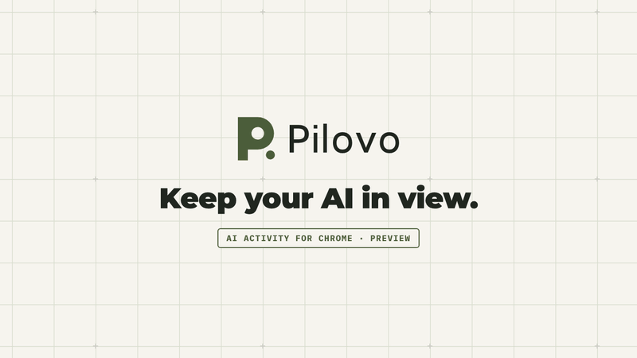

# Pilovo

**Keep your AI in view.**
AI activity for Chrome · **0.4.0 Preview**

Pilovo is an open-source Chrome extension (Manifest V3, MIT license) that shows whether the ChatGPT and Claude web tabs you authorize are working, have a response ready, need your attention or cannot be confirmed. It lists them in Chrome's side panel and counts the items to review on its toolbar badge, so you can return to the right tab. Pilovo observes a limited set of status indicators locally, with optional access per site, and does not collect your prompts, responses or tab titles.

Version 0.4.0 is an experimental preview for Chrome 120 or later, published as a GitHub prerelease on 10 October 2026 and installed manually; it is not on the Chrome Web Store. Pilovo's core is free under the MIT license; Pilovo has no backend or telemetry and needs no Pilovo account or API key. Pilovo is an independent project, not affiliated with or endorsed by the companies that operate ChatGPT or Claude.


[Install](docs/installation.md) · [FAQ](docs/faq.md) · [Français](docs/README.fr.md) · [Privacy](docs/privacy.md) · [Compatibility](docs/compatibility.md) · [Changelog](CHANGELOG.md) · [Contribute](CONTRIBUTING.md)



*Actual interface from the current source, rendered with synthetic local activity fixtures. Not a real provider session or execution proof. Screens marked UNRELEASED are available only when you build from source.*

## Pilovo at a glance

Facts about the 0.4.0 release. Last reviewed: 11 October 2026.

| Item | Pilovo 0.4.0 |
| --- | --- |
| Category | Chrome extension (Manifest V3) with a side panel and a full-page view |
| Observed services | ChatGPT (`https://chatgpt.com/*`) and Claude (`https://claude.ai/*`) web pages in Chrome tabs; experimental adapters for their English and French interfaces |
| States shown | Working, waiting, response ready (**Response available**), input requested, error visible, unknown (**Observation interrupted**) |
| Release | 0.4.0 Preview, [GitHub prerelease](https://github.com/alebgl77/pilovo/releases/tag/v0.4.0) of 10 October 2026; manual install with **Load unpacked**; not on the Chrome Web Store |
| Requirements | Chrome 120 or later; no Pilovo account, API key or companion |
| Permissions | Required: `storage`, `sidePanel`, `alarms`, `scripting`. Optional, one site at a time: `https://chatgpt.com/*`, `https://claude.ai/*` |
| Data | Prompts, responses and tab titles are not collected; activity stays in memory; no backend, telemetry or model API |
| Interface | English and French; light, dark or system theme |
| License | MIT; the core is free |

## Keep track of the ChatGPT and Claude tabs you authorize

1. **Enable one site.** Grant optional access to ChatGPT or Claude separately. Access to one does not enable the other.
2. **Work in your usual account.** Send your prompt in the provider's own interface. Pilovo observes recognized status controls; it does not collect your prompts, responses or tab titles.
3. **Return when needed.** Open the matching tab or acknowledge an attention item as seen. Seen means you noticed it, not that the task succeeded.

### What the states mean

Each observed tab on an authorized site is one row. Working, Waiting, Response ready and Attention come only from recognized indicators in the page; anything else is shown as unknown.

| State | Panel label | What it means |
| --- | --- | --- |
| Working | **Working** | A recognized indicator shows a response being generated in the page. |
| Response ready | **To review** · **Response available** | Pilovo observed work, then a stable ready signal after a short debounce. Generation has ended in the page; it does not mean the answer is correct or the task succeeded. |
| Attention | **To review** · **Your input is requested** or **An error is visible in the page** | An explicitly recognized input request or visible error. |
| Waiting | **Waiting** | The page is ready for your next message and no work is observed. |
| Unknown | **Observation interrupted** (counted as **Unconfirmed**) | Evidence is missing, expired after 15 seconds, inaccessible or not recognized. It does not mean that generation stopped or finished. |
| Seen | **Seen** | The item was marked as seen: a local acknowledgment, never verification. |

A tab merely being open, a disappearing button or an old completion announcement proves neither work nor success.

The toolbar badge shows how many last-observed items to review are still unseen. Evidence has a 15-second logical lifetime. Background tabs may be throttled; Chrome may suspend its service worker. The panel checks freshness, but badge cleanup uses a best-effort watchdog and is not a strict real-time notification guarantee. The 0.4.0 release sends no OS notifications; optional ones are listed under [Unreleased features](#unreleased-features-build-from-source).


*Actual interface rendered with synthetic local activity fixtures. These examples are not a real provider session or execution proof.*

## Unreleased features (build from source)

These features exist in the current source but not in the 0.4.0 release; build from source to use them. Tour screens that show them are marked UNRELEASED.

- **Keyboard shortcuts:** `Alt+Shift+J` (`Option+Shift+J` on macOS) goes to the next item to review; **Mark all as seen** is offered in the panel when two or more items need review, and the **Mark all items to review as seen** command has no default key. [Details](docs/installation.md#keyboard-shortcuts)
- **Automatic seen**, off by default: an item is marked as seen after its own tab stays in front for 5, 15 or 30 seconds; still a local acknowledgment only. [Details](docs/installation.md#automatic-seen)
- **System notifications**, off by default, per service: one notification from your operating system for a new item to review in a tab you are not looking at, with only the service, the reason and the session number; Chrome's optional `notifications` permission is requested only when you click. [Details](docs/installation.md#system-notifications)
- **Elapsed durations**, such as *Working for 4 min*: minute precision, never saved, restarted when evidence is lost. [Details](docs/installation.md#elapsed-durations)
- **Stable session numbers, tab positions and names**: numbers that no longer change when other tabs close, and names of up to 40 characters kept in memory for the tab's lifetime, never stored or exported. [Details](docs/installation.md#session-numbers-positions-and-names)
- **Badge colors and summary**: the count takes the color of the most urgent reason, `…` marks observed work, and the icon's tooltip gives only counts and fixed words. [Details](docs/installation.md#badge-colors-and-summary)

## Preview compatibility

Pilovo observes only the ChatGPT and Claude websites in Chrome tabs: the desktop and mobile apps and other AI websites are not supported, and browsers other than Chrome 120+ are not tested.

Initial adapters target English/French ChatGPT and Claude web interfaces. They are experimental, not universal agent coverage. On 10 October 2026, manual inspection observed ChatGPT's French streaming and completion indicators. Claude's attempted check was blocked by quota; its completion announcer still contained a finished message. Claude streaming was not captured. This is selector evidence, **not an authenticated end-to-end extension test**. Read the [compatibility record](docs/compatibility.md).

Pilovo offers focus and local acknowledgment. It does not stop, pause, resume or launch agents, send prompts, approve provider actions, inspect other extensions or control native applications. ChatGPT agent, Claude in Chrome and Claude Code/Codex supervision remain future work with separate integration requirements.

## Install in Chrome

Pilovo 0.4.0 is a Manifest V3 extension for Chrome 120+, installed manually: there is no Chrome Web Store listing or approval and no automatic update. Download `Pilovo_Chrome_v0.4.0.zip` from the [v0.4.0 prerelease](https://github.com/alebgl77/pilovo/releases/tag/v0.4.0), or [build from source](#build-from-source). Extract it, open `chrome://extensions`, enable **Developer mode**, choose **Load unpacked**, then select the folder containing `manifest.json`.

Provider account rules, plans and quotas still apply. No CLI or Node.js is needed to use the release ZIP; Node.js is only needed to build. [Detailed installation guide](docs/installation.md) · [Guide d'installation en français](docs/installation.fr.md).

## What Pilovo can see

| Permission | Purpose |
| --- | --- |
| `storage` | Local preferences; saved manual preparations live in IndexedDB. |
| `sidePanel` | Chrome side panel. |
| `alarms` | Retention maintenance and best-effort activity watchdog. |
| `scripting` | Register and sample the bundled isolated observer after a site grant. |
| Optional `https://chatgpt.com/*` or `https://claude.ai/*` | Recognize matching tabs, read supported status indicators and focus a tab; requested individually. |
| Optional `notifications` (unreleased) | System notifications for the services you check in Settings, off by default; requested when you check the first service and removed when you uncheck the last. |

Pilovo never requests the `tabs` permission, access to all sites or `nativeMessaging`. The observer reads a limited set of DOM controls and dedicated status indicators. It does not collect full conversations, prompt or response text, tab titles, screenshots, cookies or credentials. Activity metadata stays local and ephemeral; session names you type (unreleased) stay in that memory for their tab's lifetime and are never stored or exported. Optional automatic seen (unreleased, off by default) reads only which tab is active in the focused window, as IDs and flags kept in memory. Optional system notifications (unreleased, off by default) contain only the service, the reason and the session number; your operating system may keep them in its notification center. No backend, model API, remote telemetry or cloud sync is used. Revocation invalidates access; the observer's lease has a logical cutoff of at most 15 seconds, even if Chrome delays execution of cleanup. See [Privacy](docs/privacy.md) and the [technical contract](docs/core-contract.md).

## Frequently asked questions

### How do I know when ChatGPT or Claude has finished responding in another tab?

Install the Pilovo Chrome extension and connect the service, then keep Chrome's side panel open or watch Pilovo's toolbar badge: when a response has finished generating, its row moves to **To review** with **Response available**, and the badge counts the items you have not marked as seen. Pilovo reports this only after observing the tab working and then a stable ready signal; **Open session** brings that tab to the front.

### Does Pilovo send a notification or play a sound when ChatGPT or Claude finishes?

Not in 0.4.0: the released preview of the Pilovo Chrome extension shows the side panel and the badge count, with no system notification and no sound. The current source adds optional system notifications per service, off by default (unreleased; build from source), containing only the service, the reason and the session number. Your provider may offer its own notifications, which Pilovo does not change or replace.

### Does Pilovo read my conversations?

No. After you grant a site, Pilovo's observer reads a limited set of page controls and dedicated status indicators there; it does not collect full conversations, prompt or response text, tab titles, screenshots, cookies or credentials. Nothing is sent to a server: Pilovo has no backend or telemetry. See [Privacy](docs/privacy.md).

### Which permissions does Pilovo request?

Pilovo requires exactly four permissions: `storage`, `sidePanel`, `alarms` and `scripting`. Access to `https://chatgpt.com/*` and `https://claude.ai/*` is optional and requested separately for each site; the current source adds just one optional permission, `notifications` (unreleased), requested only when you click. Pilovo never requests `tabs`, access to all sites or `nativeMessaging`; see [What Pilovo can see](#what-pilovo-can-see).

### Is Pilovo on the Chrome Web Store?

No. Pilovo 0.4.0 is a GitHub prerelease that you load with **Load unpacked**, without automatic updates. See the [installation guide](docs/installation.md).

### Is Pilovo free? Do I need an account or an API key?

Pilovo's core is free under the MIT license, and you need no Pilovo account, API key or companion app. You keep using your own ChatGPT or Claude web account, with its plans and quotas.

### Does "Response available" mean my task succeeded?

No. **Response available** (response ready) means generation ended as observed in the page; Pilovo does not check the answer. Review it in the service, because your task may still need work. **Seen** only records that you noticed the item.

### Which browsers, apps and sites does Pilovo work with?

Pilovo targets Chrome 120 or later and observes only `chatgpt.com` and `claude.ai` pages in Chrome tabs. Other browsers, including other Chromium-based browsers, are not tested or claimed; Firefox and Safari are not supported, and desktop or mobile apps and other AI websites are not observed.

### Is Pilovo an official ChatGPT or Claude extension?

No. Pilovo is an independent open-source project, not affiliated with, endorsed by or sponsored by the companies that operate ChatGPT or Claude; those names only identify the services Pilovo observes.

More answers, including troubleshooting: [FAQ](docs/faq.md).

## Manual preparations remain separate

You can still prepare/copy a prompt, keep notes and missions, search, export or delete local history. You paste and send yourself. Sent/completed preparation labels remain human declarations and do not become observed activity.

Prompt retention is off for every new preparation. Without opting in, copy its text before closing the form. Titles, provider, manual status, identifiers/dates, notes and mission links are still saved. Storage and exports are **not encrypted by Pilovo**. Retention defaults to 30 days while the extension is active. Schema 2 JSON export includes saved records; import and sync are not implemented. Purge keeps preferences and minimal historical anti-replay identifiers. Uninstall removes remaining extension storage; exports, clipboard, backups and provider history are separate.

## Build from source

Use Node.js **22.12+**, npm and Git. From the repository root:

```sh
npm ci
npm run typecheck
npm test
npm run test:publication
npm run build
npm run package:check
```

Load `dist/` in Chrome. `npm run dev` is a UI preview; actual site observation requires the installed extension. After exact-artifact review, `npm run package` creates immutable versioned Chrome/source ZIPs, license notices and checksums under `release/v<version>/`. [Release gates](docs/RELEASE.md) identify checks and manual gaps.

The preserved `companion/` code is a historical experiment, unbundled and unnecessary for Pilovo. Database and protocol identifiers such as `agent-control-hub-v1` and `hub.rpc` stay stable. Briefoak 0.3.0 releases and their claims remain historical; the Pilovo activity feature begins with this preview.

## Status and contributing

No store approval, production certification, coverage percentage or user count is claimed. Benchmarks and broader integration goals in the [PRD](docs/activity-manager-prd.md) (in French) and [roadmap](docs/roadmap.md) are future targets. Changes since 0.4.0 are listed in the [changelog](CHANGELOG.md).

[Contribution guide](CONTRIBUTING.md) · [Support](SUPPORT.md) · [Security](SECURITY.md). Pilovo uses the [MIT license](LICENSE); third-party components retain their own licenses and notices.
