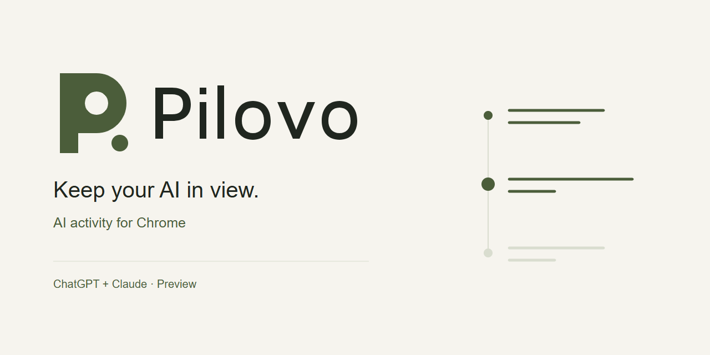
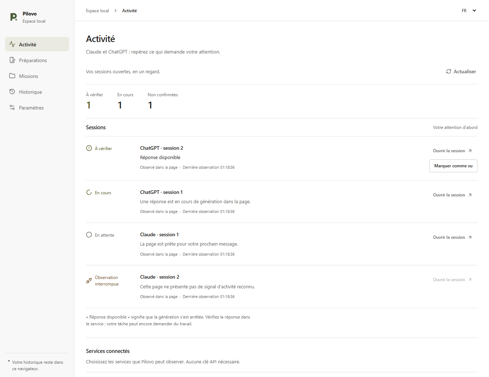

# Pilovo

**Gardez vos IA en vue.**
Activité IA pour Chrome · **Préversion 0.4.0**

Gardez le fil de vos onglets ChatGPT et Claude dans un même espace. Repérez le travail observé, remarquez une réponse prête et retrouvez la bonne session. Pilovo est une préversion expérimentale pour Chrome.

[English](../README.md) · [Installation pas à pas](installation.md) · [Confidentialité](privacy.md) · [Compatibilité](compatibility.md)

## Premier parcours

1. Ouvrez Pilovo et activez l'observation de **ChatGPT** ou de **Claude**. Chaque site demande son propre accord.
2. Utilisez votre compte web habituel et envoyez vous-même une consigne chez le fournisseur.
3. Consultez l'état observé dans Pilovo. Rejoignez le bon onglet, puis marquez une demande d'attention comme vue si vous le souhaitez.

« En cours » repose sur un indicateur reconnu. « Réponse prête » exige un travail d'abord observé, puis un signal de disponibilité stabilisé. « Vu » signifie seulement que vous avez remarqué l'élément. Un onglet ouvert ou une vieille annonce de fin ne prouve ni exécution ni réussite.

**Raccourcis clavier** (non publiés ; construisez les sources d'ici la prochaine version). `Alt+Maj+J` (`Option+Maj+J` sur macOS) rejoint le prochain élément à vérifier : l'attention non vue la plus ancienne, revalidée comme **Ouvrir la session** ; si cette vérification montre qu'elle n'est plus à vérifier, la suivante est essayée. S'il n'y a rien à vérifier, le panneau latéral s'ouvre. **Marquer tous les éléments à vérifier comme vus** n'a pas de touche par défaut ; attribuez-la, ou modifiez `Alt+Maj+J`, dans `chrome://extensions/shortcuts`. Dès que deux éléments ou plus sont à vérifier, le panneau propose aussi **Tout marquer comme vu**. Comme « Vu », cette action reste locale et signifie seulement que vous les avez remarqués.

**Durées écoulées** (non publiées ; depuis les sources). Une ligne en cours indique depuis combien de temps ce travail est observé, par exemple **En cours depuis 4 min** ; un élément à vérifier, vu ou non, indique depuis combien de temps son signal est affiché, par exemple **Réponse disponible depuis 2 min**. Ces durées, à la minute près, sont calculées dans la mémoire du panneau à partir du moment où Pilovo a observé l'état actuel dans cette page. Elles ne sont jamais enregistrées, exportées ni transmises. Comme le modèle de preuve est prudent, une durée repart de zéro dès que Pilovo perd la preuve de cet état : aucun signal reconnu, échec de la vérification de la page, preuve expirée, navigation ou rechargement, redémarrage du service worker. Elle peut donc être plus courte que la durée réelle et ne correspond pas à un temps de génération communiqué par le fournisseur. Si seul le panneau ne peut pas confirmer l'activité (actualisation en échec, service d'activité indisponible ou modification d'un accès en cours), les durées sont masquées ; elles réapparaissent inchangées dès que des données fraîches confirment la même observation continue.

« Inconnu » signifie que la preuve manque, a expiré ou n'est plus accessible. Les onglets en arrière-plan peuvent être ralentis par Chrome. La preuve expire logiquement après 15 secondes. Le badge représente la dernière attention observée ; son effacement dépend aussi du réveil du service worker et n'est pas garanti en temps réel. Aucune notification système n'est envoyée.

*Interface réelle alimentée par des fixtures locales synthétiques. Cette capture ne représente pas une session fournisseur réelle ni une preuve d'exécution.*

## Installer la préversion

Chrome 120+ est requis. Pilovo n'est pas encore approuvé sur le Chrome Web Store. Téléchargez une archive revue `Pilovo_Chrome_v0.4.0.zip` si elle est disponible dans les [versions](https://github.com/alebgl77/pilovo/releases), ou [construisez les sources](../README.md#build-from-source).

Décompressez le ZIP, ouvrez `chrome://extensions`, activez **Mode développeur**, puis **Charger l'extension non empaquetée**. Sélectionnez le dossier qui contient directement `manifest.json` et épinglez Pilovo. Le [guide d'installation](installation.md) explique les accords individuels et leur retrait.

Le cœur est gratuit sous MIT. Aucun compte Pilovo, clé API, compagnon, CLI ou Node.js n'est requis pour utiliser l'extension. Les comptes, abonnements et quotas des fournisseurs restent applicables.

## Données et limites

L'observateur isolé est activé uniquement sur le site autorisé. Il examine des contrôles et indicateurs d'état du DOM, sans collecter les consignes, réponses complètes, titres d'onglets, captures, cookies ou identifiants. Les métadonnées d'activité sont locales et temporaires ; elles sont reconstruites avec des preuves fraîches après redémarrage. Le retrait d'accès invalide l'observation ; le bail local impose une coupure logique sous 15 secondes, même si Chrome retarde le nettoyage.

Les adaptateurs EN/FR sont expérimentaux. Une inspection manuelle a vu les indicateurs ChatGPT FR le 10 octobre 2026. Le test Claude était bloqué par quota, malgré une annonce de fin persistante ; son streaming n'a pas été capturé. Ces observations ne valident pas un parcours réel de bout en bout de l'extension. Voir la [matrice de compatibilité](compatibility.md).

Pilovo permet de rejoindre un onglet et d'acquitter localement l'attention. Il ne lance, n'arrête ou ne met en pause aucun agent, ne soumet ni consigne ni approbation et ne pilote pas Claude Code/Codex ou une autre extension. Aucun backend, API de modèle, suivi distant ou synchronisation cloud.

## Vos préparations manuelles

Les préparations, notes et missions restent disponibles séparément. Copiez puis envoyez vous-même ; leurs statuts restent vos déclarations. Conserver une consigne exige un choix distinct, décoché à chaque création. Titres, dates, notes et liens de mission sont enregistrés même sans conservation de la consigne.

Le stockage et les exports ne sont pas chiffrés par Pilovo. La rétention de l'historique vaut 30 jours par défaut, lorsque l'extension est active. Export JSON 2 disponible, sans import ni synchronisation. La purge garde les préférences et les identifiants historiques minimaux contre le rejeu. Exports, sauvegardes, presse-papiers et conversations fournisseur se gèrent séparément. [Notice de confidentialité](privacy.md).

[Contribuer](../CONTRIBUTING.md) · [Assistance](../SUPPORT.md) · [Feuille de route](roadmap.md) · [Licence MIT](../LICENSE). Les anciennes livraisons Briefoak restent un historique distinct.
