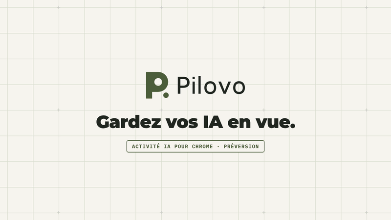

# Pilovo

**Gardez vos IA en vue.**
Activité IA pour Chrome · **Préversion 0.4.0**

Gardez le fil de vos onglets ChatGPT et Claude dans un même espace. Repérez le travail observé, remarquez une réponse prête et retrouvez la bonne session. Pilovo est une préversion expérimentale pour Chrome.

[English](../README.md) · [Installation pas à pas](installation.md) · [Confidentialité](privacy.md) · [Compatibilité](compatibility.md)

*Interface réelle issue des sources actuelles, alimentée par des fixtures locales synthétiques. Ce n'est ni une session fournisseur réelle ni une preuve d'exécution. Les écrans marqués NON PUBLIÉ ne sont disponibles qu'en compilant depuis les sources.*

## Premier parcours

1. Ouvrez Pilovo et activez l'observation de **ChatGPT** ou de **Claude**. Chaque site demande son propre accord.
2. Utilisez votre compte web habituel et envoyez vous-même une consigne chez le fournisseur.
3. Consultez l'état observé dans Pilovo. Rejoignez le bon onglet, puis marquez une demande d'attention comme vue si vous le souhaitez.

« En cours » repose sur un indicateur reconnu. « Réponse prête » exige un travail d'abord observé, puis un signal de disponibilité stabilisé. « Vu » signifie seulement que vous avez remarqué l'élément. Un onglet ouvert ou une vieille annonce de fin ne prouve ni exécution ni réussite.

**Raccourcis clavier** (non publiés ; construisez les sources d'ici la prochaine version). `Alt+Maj+J` (`Option+Maj+J` sur macOS) rejoint le prochain élément à vérifier : l'attention non vue la plus ancienne, revalidée comme **Ouvrir la session** ; si cette vérification montre qu'elle n'est plus à vérifier, la suivante est essayée. S'il n'y a rien à vérifier, le panneau latéral s'ouvre. **Marquer tous les éléments à vérifier comme vus** n'a pas de touche par défaut ; attribuez-la, ou modifiez `Alt+Maj+J`, dans `chrome://extensions/shortcuts`. Dès que deux éléments ou plus sont à vérifier, le panneau propose aussi **Tout marquer comme vu**. Comme « Vu », cette action reste locale et signifie seulement que vous les avez remarqués.

**« Vu » automatique** (non publié ; depuis les sources ; désactivé par défaut). Dans **Paramètres**, **Marquer comme vu automatiquement** peut valoir 5, 15 ou 30 secondes. Un élément à vérifier est alors marqué comme vu dès que son propre onglet est resté aussi longtemps l'onglet actif de la fenêtre Chrome active, panneau latéral ouvert à côté ou non ; la vue complète de Pilovo, un autre onglet, une autre fenêtre ou une autre application au premier plan ne comptent pas. Changer d'onglet ou de fenêtre, quitter Chrome, naviguer, fermer l'onglet, retirer l'accès à ce site, un nouveau signal dans l'onglet ou un « Vu » manuel interrompt l'attente, qui repart de zéro lorsque l'onglet revient au premier plan ; juste avant de marquer l'élément, Pilovo redemande à Chrome quel onglet est au premier plan. Une fois activé, le bas de la page Activité rappelle ce délai. Comme un « Vu » manuel, il reste local et signifie seulement que l'onglet était devant vous : il ne vérifie, n'approuve ni ne termine jamais la tâche. Pour savoir quel onglet est au premier plan, Pilovo lit uniquement les identifiants d'onglets et de fenêtres et leurs indicateurs « actif » et « active », dans la mémoire du service worker ; aucune nouvelle permission n'est nécessaire. Le réglage lui-même est enregistré avec vos autres préférences et figure dans l'export.

**Notifications système** (non publiées ; depuis les sources ; désactivées par défaut). Dans **Paramètres**, rubrique **Activité**, **Notifications système** propose une case par service, **Claude** et **ChatGPT**. Cocher la première demande à Chrome sa permission facultative `notifications` ; si vous refusez, rien ne change. Pilovo affiche alors une notification de votre système quand un nouvel élément à vérifier apparaît pour un service coché : une réponse disponible, une intervention demandée ou une erreur visible. Elle contient seulement le service, le motif et le numéro de session, par exemple **ChatGPT** · *Intervention demandée · session 2*, jamais un nom de session, un titre d'onglet, une adresse ni le contenu d'une conversation. Aucune notification pour l'onglet que vous regardez (l'onglet actif de la fenêtre Chrome active) ni pour un élément déjà présent quand vous avez coché le service. Quand Chrome ralentit un onglet en arrière-plan et que la preuve expire, la notification reste au plus 35 secondes et continue de désigner le même signal si Pilovo le relit entre-temps dans cet onglet, sans notifier deux fois. Un clic l'efface et ouvre cette session avec la même revalidation que **Ouvrir la session** (en relisant d'abord l'onglet si sa preuve avait expiré), sans la marquer comme vue. Elle s'efface quand l'élément est vu (à la main, avec **Tout marquer comme vu** ou par le « Vu » automatique), à un nouveau signal, quand la preuve reste expirée plus de 35 secondes, à la navigation, à la fermeture de l'onglet, au retrait de l'accès au site ou en décochant le service. Décocher le dernier service efface les notifications de Pilovo, puis retire la permission de Chrome. Si la permission est retirée ailleurs, Chrome ne laisse plus Pilovo effacer les notifications déjà affichées : votre système peut les garder jusqu'à ce que vous les fermiez (Pilovo les efface si vous autorisez de nouveau les notifications) ; les Paramètres montrent les deux services désactivés et vous laissent en cocher un à nouveau. Votre système décide de l'affichage des notifications et peut les conserver dans son centre de notifications.

**Durées écoulées** (non publiées ; depuis les sources). Une ligne en cours indique depuis combien de temps ce travail est observé, par exemple **En cours depuis 4 min** ; un élément à vérifier, vu ou non, indique depuis combien de temps son signal est affiché, par exemple **Réponse disponible depuis 2 min**. Ces durées, à la minute près, sont calculées dans la mémoire du panneau à partir du moment où Pilovo a observé l'état actuel dans cette page. Elles ne sont jamais enregistrées, exportées ni transmises. Comme le modèle de preuve est prudent, une durée repart de zéro dès que Pilovo perd la preuve de cet état : aucun signal reconnu, échec de la vérification de la page, preuve expirée, navigation ou rechargement, redémarrage du service worker. Elle peut donc être plus courte que la durée réelle et ne correspond pas à un temps de génération communiqué par le fournisseur. Si seul le panneau ne peut pas confirmer l'activité (actualisation en échec, service d'activité indisponible ou modification d'un accès en cours), les durées sont masquées ; elles réapparaissent inchangées dès que des données fraîches confirment la même observation continue.

**Numéros, positions et noms des sessions** (non publiés ; depuis les sources). Chaque ligne garde un numéro stable par service, par exemple **Claude · session 3**. Pilovo l'attribue dès la première observation de l'onglet et le conserve tant que cet onglet reste ouvert sur ce service, même si d'autres onglets se ferment ou si la page navigue. La numérotation repart après un redémarrage du service worker de l'extension, et un onglet qui quitte le service puis y revient reçoit un nouveau numéro. Une ligne secondaire indique la position de l'onglet dans sa fenêtre, par exemple **Onglet 4**, et ajoute **autre fenêtre** quand l'onglet n'est pas dans la fenêtre qui affiche Pilovo. Pour distinguer vos sessions, choisissez le bouton crayon (**Nommer cette session**) et saisissez un nom de 40 caractères au plus, par exemple *Revue contrat* ; la ligne devient **Revue contrat — Claude · session 3**, en gardant le numéro qu'utilisent les notifications système. Entrée ou la sortie du champ applique le nom, Échap annule, un nom vide l'efface. Comme l'ouverture d'une session, nommer demande une preuve à jour : une ligne dont la preuve a expiré peut être renommée dès que Pilovo l'observe à nouveau. Ce nom reste uniquement dans la mémoire de l'extension pour cet onglet : il survit à la navigation dans l'onglet, ne s'affiche que lorsque l'onglet est sur le service où vous l'avez nommé, et disparaît à la fermeture de l'onglet, au retrait de l'accès à ce site ou au redémarrage du service worker. Il n'est jamais stocké, exporté, transmis, ni affiché sur le badge ou son info-bulle. Pilovo n'affiche toujours ni titre d'onglet ni adresse.

« Inconnu » signifie que la preuve manque, a expiré ou n'est plus accessible. Les onglets en arrière-plan peuvent être ralentis par Chrome. La preuve expire logiquement après 15 secondes. Le badge indique le nombre d'éléments à vérifier encore non vus, d'après la dernière observation. **Couleurs et résumé du badge** (non publiés ; depuis les sources) : le nombre prend la couleur du motif le plus urgent, rouge pour une erreur visible, brun ambré pour une intervention demandée, olive pour une réponse disponible. S'il n'y a rien à vérifier mais qu'un travail est observé, il affiche « … » sur fond gris, sans nombre ; les éléments vus, les sessions en attente et les états inconnus ne l'allument jamais. Au survol de l'icône Pilovo, le même résumé apparaît en texte, dans la langue choisie dans les paramètres de Pilovo, par exemple « Pilovo — 3 à vérifier, dont 1 erreur visible · 1 en cours ». Le badge et son info-bulle ne contiennent que des nombres et ces mots fixes, jamais de titre, d'adresse ni de contenu de conversation. Son effacement dépend aussi du réveil du service worker et n'est pas garanti en temps réel. La version 0.4.0 n'envoie aucune notification système ; les sources non publiées ajoutent les notifications facultatives décrites plus haut.

*Interface réelle alimentée par des fixtures locales synthétiques. Cette capture ne représente pas une session fournisseur réelle ni une preuve d'exécution.*

## Installer la préversion

Chrome 120+ est requis. Pilovo n'est pas encore approuvé sur le Chrome Web Store. Téléchargez une archive revue `Pilovo_Chrome_v0.4.0.zip` si elle est disponible dans les [versions](https://github.com/alebgl77/pilovo/releases), ou [construisez les sources](../README.md#build-from-source).

Décompressez le ZIP, ouvrez `chrome://extensions`, activez **Mode développeur**, puis **Charger l'extension non empaquetée**. Sélectionnez le dossier qui contient directement `manifest.json` et épinglez Pilovo. Le [guide d'installation](installation.md) explique les accords individuels et leur retrait.

Le cœur est gratuit sous MIT. Aucun compte Pilovo, clé API, compagnon, CLI ou Node.js n'est requis pour utiliser l'extension. Les comptes, abonnements et quotas des fournisseurs restent applicables.

## Données et limites

L'observateur isolé est activé uniquement sur le site autorisé. Il examine des contrôles et indicateurs d'état du DOM, sans collecter les consignes, réponses complètes, titres d'onglets, captures, cookies ou identifiants. Les métadonnées d'activité sont locales et temporaires ; elles sont reconstruites avec des preuves fraîches après redémarrage. Les noms de session que vous saisissez (non publiés) restent dans cette mémoire le temps de vie de leur onglet, sans jamais être enregistrés ni exportés. Le « Vu » automatique facultatif (non publié, désactivé par défaut) lit seulement quel onglet est actif dans la fenêtre active, sous forme d'identifiants et d'indicateurs gardés en mémoire. Les notifications système facultatives (non publiées, désactivées par défaut) contiennent seulement le service, le motif et le numéro de session ; votre système peut les conserver dans son centre de notifications. Le retrait d'accès invalide l'observation ; le bail local impose une coupure logique sous 15 secondes, même si Chrome retarde le nettoyage.

Les adaptateurs EN/FR sont expérimentaux. Une inspection manuelle a vu les indicateurs ChatGPT FR le 10 octobre 2026. Le test Claude était bloqué par quota, malgré une annonce de fin persistante ; son streaming n'a pas été capturé. Ces observations ne valident pas un parcours réel de bout en bout de l'extension. Voir la [matrice de compatibilité](compatibility.md).

Pilovo permet de rejoindre un onglet et d'acquitter localement l'attention. Il ne lance, n'arrête ou ne met en pause aucun agent, ne soumet ni consigne ni approbation et ne pilote pas Claude Code/Codex ou une autre extension. Aucun backend, API de modèle, suivi distant ou synchronisation cloud.

## Vos préparations manuelles

Les préparations, notes et missions restent disponibles séparément. Copiez puis envoyez vous-même ; leurs statuts restent vos déclarations. Conserver une consigne exige un choix distinct, décoché à chaque création. Titres, dates, notes et liens de mission sont enregistrés même sans conservation de la consigne.

Le stockage et les exports ne sont pas chiffrés par Pilovo. La rétention de l'historique vaut 30 jours par défaut, lorsque l'extension est active. Export JSON 2 disponible, sans import ni synchronisation. La purge garde les préférences et les identifiants historiques minimaux contre le rejeu. Exports, sauvegardes, presse-papiers et conversations fournisseur se gèrent séparément. [Notice de confidentialité](privacy.md).

[Contribuer](../CONTRIBUTING.md) · [Assistance](../SUPPORT.md) · [Feuille de route](roadmap.md) · [Licence MIT](../LICENSE). Les anciennes livraisons Briefoak restent un historique distinct.
