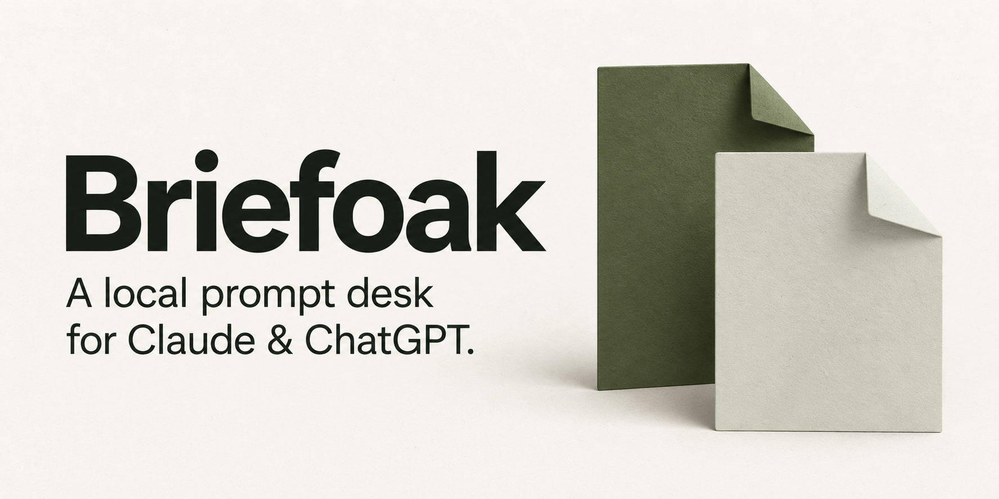
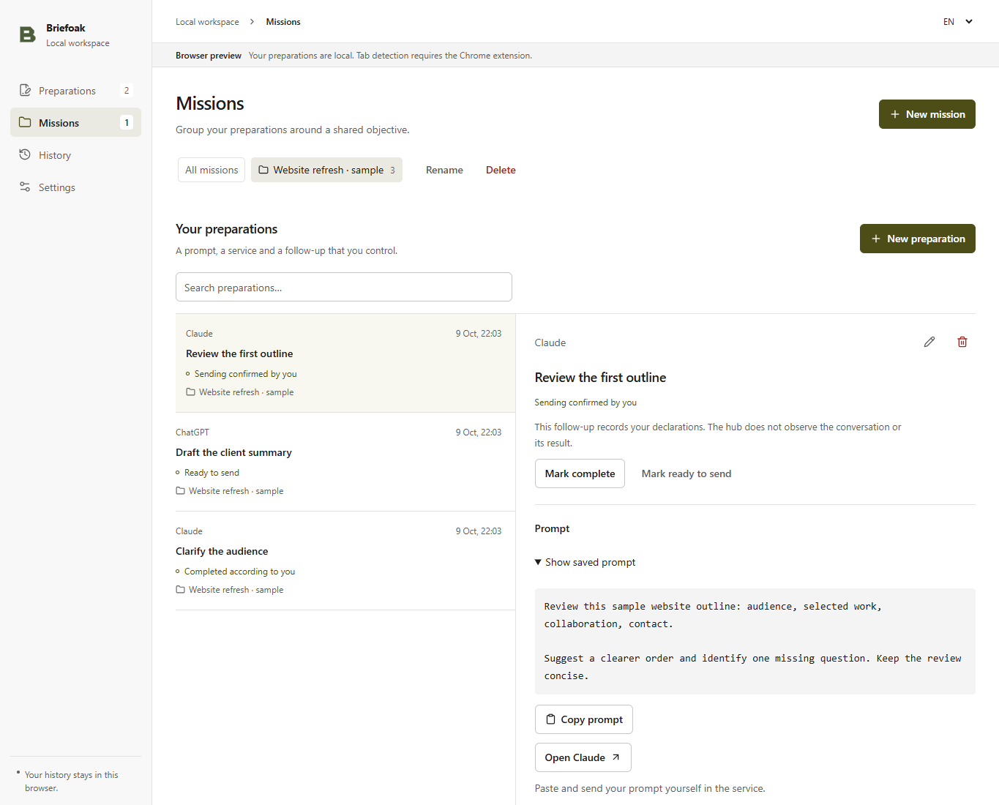

# Briefoak

**Un bureau local pour vos consignes Claude et ChatGPT.**

Préparez une consigne, rassemblez le travail d'une mission et retrouvez ce que vous avez envoyé. Briefoak accompagne vos comptes web habituels dans le panneau latéral de Chrome ou dans un onglet complet.

[English](../README.md) · [Installation](installation.md) · [Confidentialité](privacy.md) · [Versions](https://github.com/alebgl77/briefoak/releases)

*Aperçu navigateur de Briefoak avec des exemples locaux fictifs. Les statuts sont déclarés manuellement ; aucune exécution fournisseur n'est montrée.*

## Trois étapes

1. **Préparez.** Choisissez Claude ou ChatGPT, donnez un titre et rédigez votre consigne. Une mission peut regrouper plusieurs préparations. Conserver la consigne est un choix distinct, décoché pour chaque nouvelle préparation.
2. **Envoyez vous-même.** Copiez, ouvrez l'application, puis collez et envoyez dans votre compte web. Ouvrir un onglet n'envoie rien.
3. **Gardez le fil.** Déclarez l'envoi puis la fin dans Briefoak. Ajoutez une note locale pour reprendre votre travail.

Recherche, notes, missions, export JSON, suppression, rétention, français/anglais et thèmes clair/sombre/système sont disponibles.

## Installer

Téléchargez le ZIP Chrome dans les [versions](https://github.com/alebgl77/briefoak/releases), décompressez-le, ouvrez `chrome://extensions`, activez le mode développeur puis **Charger l'extension non empaquetée**. Sélectionnez le dossier contenant `manifest.json`. Si aucune archive n'est encore publiée, suivez la [construction depuis les sources](../README.md#build-from-source).

Chrome 120+ est requis. Il s'agit d'une première version à installer manuellement, sans publication Chrome Web Store. Aucun compagnon, CLI, Node.js, clé API ou compte Briefoak n'est requis pour l'utiliser. Les règles, abonnements et quotas des fournisseurs s'appliquent.

## Des limites visibles

L'accès facultatif aux seuls sites `claude.ai` et `chatgpt.com`, demandé ensemble, permet de retrouver leurs onglets. Sans accord, l'ouverture des sites officiels reste possible. Un onglet présent ne prouve ni connexion ni activité.

Briefoak ne lit pas les conversations, réponses, cookies ou identifiants. Il n'envoie pas de consigne, ne pilote aucun agent et ne vérifie pas l'exécution. Les statuts sont vos déclarations. Aucun backend, appel d'API de modèle, suivi distant ou synchronisation cloud.

Les données restent dans votre profil Chrome, **sans chiffrement ajouté par Briefoak**. La consigne n'est enregistrée qu'avec votre accord pour cette préparation ; sans accord, copiez-la avant de fermer le formulaire. Titres, statuts, dates, identifiants et notes saisies séparément restent enregistrés. La rétention vaut 30 jours par défaut et fonctionne lorsque l'extension est active.

L'export JSON version 2 est disponible, sans fonction d'import. La purge conserve préférences et identifiants minimaux historiques contre le rejeu. La désinstallation efface le stockage restant de l'extension ; exports, sauvegardes, presse-papiers et conversations fournisseur se gèrent séparément. Consultez la [notice](privacy.md) et le [contrat technique](core-contract.md).

[Contribuer](../CONTRIBUTING.md) · [Assistance](../SUPPORT.md) · [Feuille de route proposée](roadmap.md). Briefoak est disponible sous [licence MIT](../LICENSE). Les composants tiers conservent leurs propres licences ; leurs notices accompagnent les archives.
